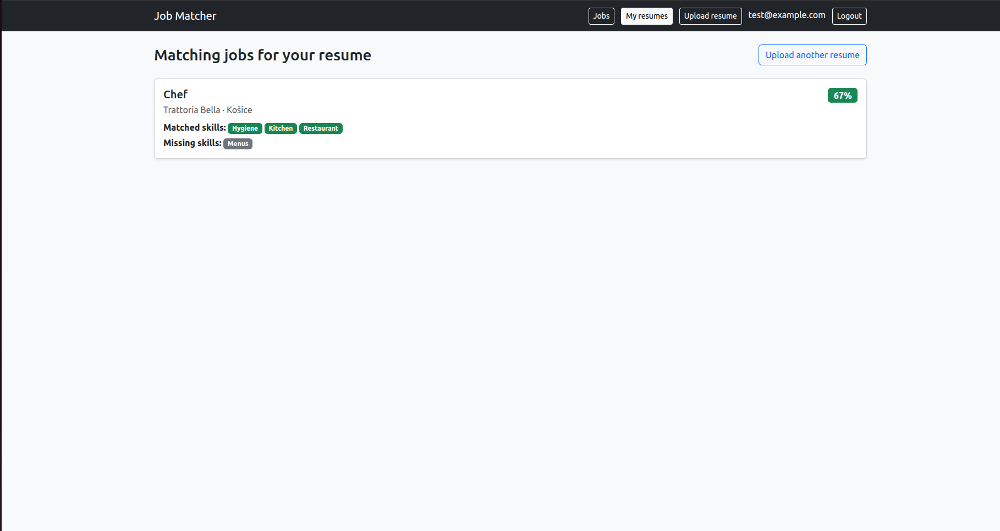
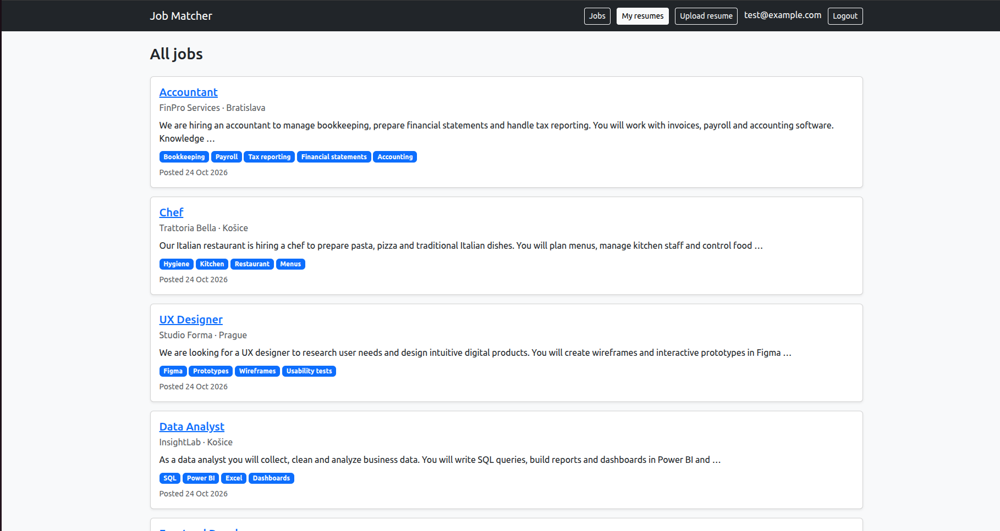

# Job Matcher

AI-powered job board built with Django. Job seekers upload a PDF resume, and the app ranks vacancies by how well they match — using semantic search (embeddings + pgvector) combined with skill matching.



## Features

- **AI matching** — resumes and jobs are converted to embeddings with a multilingual sentence-transformer model and compared by cosine distance in PostgreSQL (pgvector)
- **Skill analysis** — skills are extracted from both resume and job description; each match shows which skills you have and which are missing
- **Combined score** — 60% skill overlap + 40% semantic similarity, with a 60% threshold and pagination
- **Two user roles** — employers post and manage vacancies, job seekers upload resumes and see matches
- **Full CRUD** for jobs and resumes with ownership checks (users can only edit their own data)
- **Multilingual** — works with English, Ukrainian and Slovak texts
- **Tests** for access control and score calculation

## How matching works

1. Text is extracted from the uploaded PDF (`pdfplumber`)
2. The text is turned into a 384-dimensional vector (`paraphrase-multilingual-MiniLM-L12-v2`)
3. PostgreSQL ranks all jobs by cosine distance to the resume vector
4. Skills from a dictionary are found in both texts and compared
5. Final score = `0.6 × skill overlap + 0.4 × semantic similarity`

## Tech stack

Python · Django 5 · PostgreSQL + pgvector · sentence-transformers · PyTorch (CPU) · pdfplumber · Bootstrap 5 · crispy-forms · Docker

## Getting started

### 1. Database (PostgreSQL with pgvector)

```bash
docker run --name jobdb -e POSTGRES_PASSWORD=postgres -e POSTGRES_DB=jobdb \
  -p 5432:5432 -d pgvector/pgvector:pg16
```

### 2. Project

```bash
git clone https://github.com/YOUR_USERNAME/job_matcher.git
cd job_matcher
python -m venv venv
source venv/bin/activate
pip install torch --index-url https://download.pytorch.org/whl/cpu
pip install -r requirements.txt
```

### 3. Environment variables

```bash
cp .env.example .env
```

Fill in `SECRET_KEY` and database credentials in `.env`.

### 4. Run

```bash
python manage.py migrate
python manage.py createsuperuser
python manage.py runserver
```

Open http://127.0.0.1:8000

## Running tests

```bash
python manage.py test
```

## Screenshots

| Job list | Match results |
|---|---|
|  |  |

## Roadmap

- [ ] Docker Compose for one-command setup
- [ ] Background embedding computation with Celery + Redis
- [ ] LLM-based skill extraction
- [ ] Deployment and CI with GitHub Actions